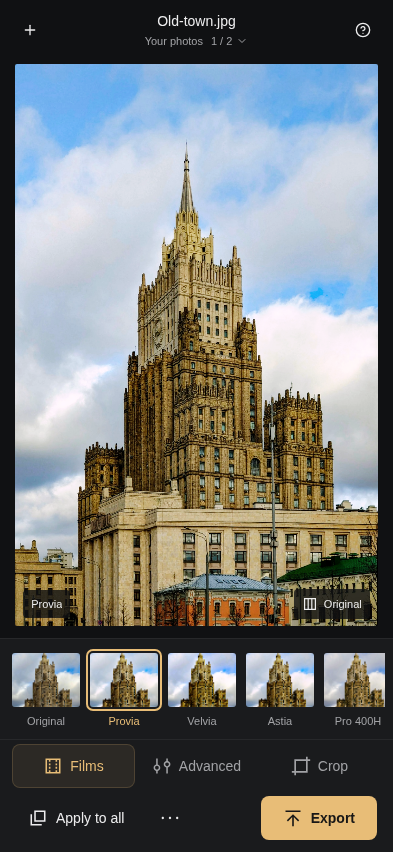
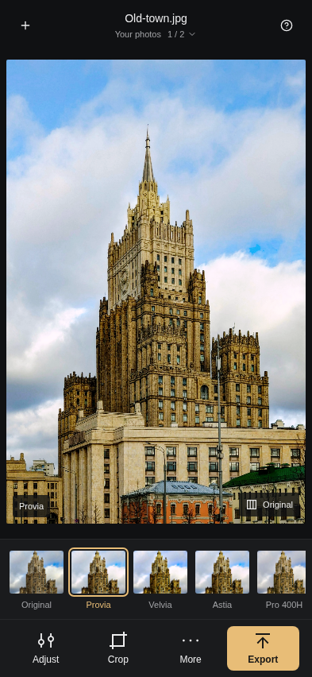
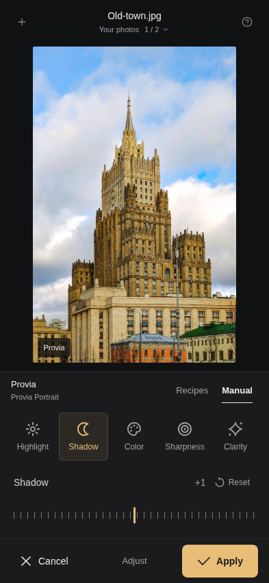
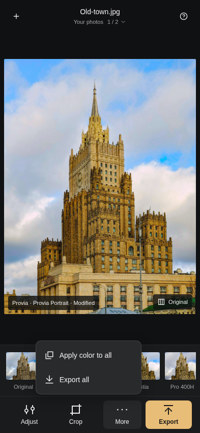
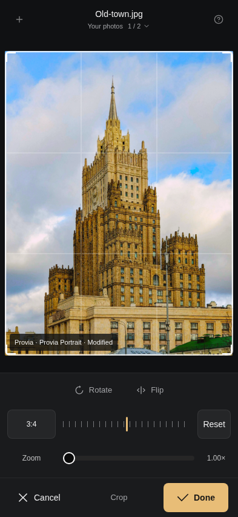
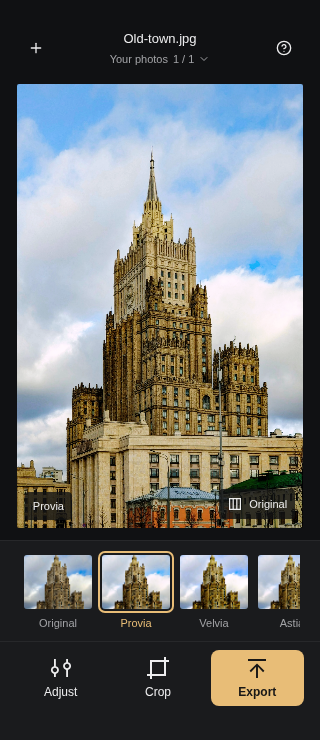

# PhotoChrome — guideline-led mobile refinement

Application / recording source: **`e7fad82633e3a1f82a1255d16e5bcaef84a76b63`** on `codex/mobile-darkroom-2026-10-25`. Built locally and recorded from the production preview of that clean commit. Subsequent review commits contain evidence only; application code is identical. No PR, main update, merge or production deployment.

[Official-source audit and deliberate adaptations](AUDIT.md) · [MP4 walkthrough](PhotoChrome-mobile-guidelines.mp4) · [Artifact sizes and SHA-256](artifacts.json)

The prior idle footer stacked a mode strip and a second action strip. It now presents **Adjust · Crop · More · Export** in one row, recovering about 40 CSS px in the two-photo view. Batch actions move into More. Temporary edits retain Cancel / task / Apply or Done, and the underlying owner-bound draft model remains intact. Added 48 CSS px mobile targets, consistent safe-area insets, clearer tool names, focus-aware overflow dismissal, popup-first Escape for crop ratios, and visible batch completion feedback. Official Iconoteka paths and the MIT license are unchanged.

## Actual interface walkthrough

The video is 58.8 seconds, portrait H.264 / yuv420p, 786×1784, 12,106,975 bytes. It shows the actual running app at a 393×852 CSS viewport, in Chromium mobile emulation. A small caption band is outside the app; only startup is trimmed, with no retiming, desktop inserts or fabricated screens.

1. **Import and films — passed:** two non-sensitive photos, a selected film and touch-hold comparison.
2. **Recipes — passed:** select a recipe in the same temporary draft.
3. **Manual — passed:** adjust controls, Cancel restores exact baseline pixels; reopen and Apply commits the recipe and controls together.
4. **Crop — passed:** rotation Cancel restores composition; choose 3:4 and confirm.
5. **Batch and collection — passed:** More applies color with visible status; open the collection and switch portrait/landscape independently.
6. **Export — passed:** actual JPEG (1200×1600) and valid ZIP with two decoded JPEGs; completion and return to editing.

Browser playback advanced normally, five seeks rendered distinct frames, orientation was portrait and there was no media error. FFmpeg decoded the entire file without errors. See [recording checks](recording-verification.json), [playback checks](playback-verification.json), and [download validation](export-verification.json). Capture scripts are retained as provenance of this executor run; their absolute local paths are not paths in the parent's workspace.

## Representative states

Before / after, the imported portrait with two photos:

 

Manual draft and More:

 

Crop and narrow safe-area conditions:

 

[Recipe view](PhotoChrome-guidelines-recipes.png) · [Contained landscape image](PhotoChrome-guidelines-landscape.png)

## Verification

Final suite outcomes: All browser checks use system Chromium 151.0.7922.173; mobile runs are emulation, not physical Android or iPhone.

| Check | Final result |
| --- | --- |
| ESLint, Knip, application build/typecheck | Passed |
| Unit and E2E TypeScript configurations | Passed |
| Unit suite | 179 passed, 29 files |
| Full Chromium E2E | 201 passed, 4 skipped, 0 failed |
| Mobile Chrome E2E, separate run | 75 passed, 5 skipped, 0 failed |
| Focused bottom-panel checks | 6 passed; included in full suites |
| Rendered QA | 320/393px, portrait/landscape, 1440px desktop, 34px bottom / 12px side / 24px top simulated safe areas; no page overflow |
| Keyboard/accessibility | Focus restoration, More dismissal, popup-first Escape, 200% text, reduced motion, axe scans passed |
| Editing/data | Repeated Apply/Cancel, interrupted/failed previews, import cancellation/retry, source ownership, geometry and photo/video export passed |
| Recording and downloads | Browser playback/seeks and complete decode passed; JPEG and ZIP contents decoded |

The four Chromium skips are two mobile-only completion cases, Crop in the intentionally restricted demo, and a source-AAC configuration unsupported by this runtime. The five mobile skips are desktop-only completion cases. No final check failed.

[Chromium log](chromium-final.log) · [Mobile log](mobile-final.log) · [Unit log](unit.log) · [Build log](build.log) · [Machine-readable results](verification.json)

Previously failed checks were resolved, not ignored: three stale assertions in the initial focused run and one stale demo assertion in the first full run still expected the removed Films control or directly visible batch action. The first full run otherwise had 200 passed / 4 skipped. An overlapping mobile run lost its shared temporary server and was stopped: 10 connection failures, 2 interrupted, 40 passed, 5 skipped, 23 not run. The final complete suites run sequentially.

Unavailable: Firefox and WebKit binaries, physical iOS/Android/Safari testing, VoiceOver/TalkBack and device-specific AAC acceptance. The installed browser directory contains only Playwright's FFmpeg; these checks are not represented as passed. Axe and keyboard checks are not a claim of full assistive-technology certification. Existing build warning: the main JS chunk exceeds 500 kB.

## Delivery and CI

Library upload was attempted with the current official batch helper and failed before preparing or writing files: `library upload failed: hosted apps tools/list request failed: network`. No Library IDs were created. The exact review files are committed here for authorized parent retrieval and native attachment delivery. Local executor paths are not transferable to the parent.

The repository's CI workflow triggers only for pushes to main or PRs targeting main. This review branch has no PR, so a missing run is not a green CI result. The handoff reports the exact remotely verified commit and queried CI status.
